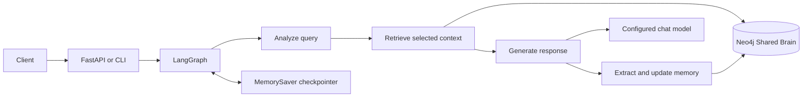

# MyNaksh

## Architecture

The FastAPI endpoint and terminal client both call the LangGraph chat workflow. The graph analyzes each query, retrieves selected Neo4j context, generates a response with the configured LLM provider, and extracts durable memory updates.



The graph nodes run in order: `analyze_query`, `retrieve_brain`, `generate_response`, and `update_memory`. The LLM factory supports Google Gemini, OpenAI, and a local stub provider.

## Shared Brain Schema

- `(:User {user_id, name?, dob?, pob?, tob?, preferred_language?, zodiac?})` stores profile attributes.
- `(:User)-[:HAS_MEMORY {type}]->(:MemoryItem {user_id, key, value, category, timeframe, updated_at})` stores canonical facts. A composite uniqueness constraint on `(user_id, key)` makes updates target the same memory item.
- `(:User)-[:SENT]->(:Message {content, created_at})` and `(:User)-[:RECEIVED]->(:Message {content, created_at})` store conversation exchanges.

The database also enforces uniqueness for `User.user_id`. Schema constraints are initialized by the app when Neo4j is enabled.

## Terminal Chat

Start an interactive chat from the repository root:

```powershell
.\.venv\Scripts\python.exe -m app.cli
```

The CLI prompts for a stable user ID (default: `local-user`) and generates a session ID for the run. Every message in that run shares the same session, so follow-up questions work automatically. Use `--user-id` to select long-term memory for a user, `--session-id` to set a session ID, and type `exit` or `quit` to leave the chat.

## Memory Design

### Short-Term and Long-Term Memory

Short-term conversation history is managed by LangGraph's `MemorySaver` checkpointer. The API scopes each checkpoint thread to `user_id:session_id`, keeping users and sessions isolated. Response generation uses only the latest six messages, preserving follow-up context such as "Why do you say that?" without sending the full conversation to the LLM.

Long-term profile data and memories are stored in Neo4j by `user_id`, so they can be retrieved across sessions.

### Memory Filtering and Conflict Resolution

The structured memory extractor uses `should_store` to decide whether extracted facts are durable enough to save. Greetings, chitchat, and transient questions should not become long-term facts. Explicit profile updates are upserted separately, and conversation exchanges are persisted as chat history.

Each fact uses a canonical key, such as `career_goal`. Neo4j `MERGE` matches a memory by its user and key, allowing later corrections to update the existing fact instead of creating a conflicting duplicate.

### Selective Context Retrieval

Before retrieval, `analyze_query_node` classifies a message into relevant life domains, such as `career`, `relationships`, or `finance`. Neo4j filters memories with `WHERE m.category IN $categories`, so unrelated facts are not added to the response context. The API's `context_used` field reports which profile or memory information was included.

## Design Decisions and Trade-offs

- **Separate short- and long-term memory:** `MemorySaver` makes local follow-ups simple; Neo4j preserves user facts across sessions. The in-memory checkpointer is not suitable for durable or multi-instance production use.
- **Structured extraction and canonical keys:** typed output and keyed upserts make stored facts easier to filter and correct, but extraction quality depends on the model and prompts.
- **Category-filtered retrieval:** limiting retrieval reduces irrelevant prompt context and token use, but a classifier that misses a category can omit a useful memory.
- **Provider abstraction:** OpenAI, Google Gemini, and the stub can be selected without changing graph logic. The stub is deterministic but does not provide personalized model reasoning.
- **Graceful Neo4j fallback:** chat can respond when Neo4j is unavailable, but that turn may lack long-term context and cannot persist new memories.

## Sample API Request and Response

Send `POST /chat` with:

```json
{
	"user_id": "rahul",
	"session_id": "session-1",
	"message": "What should I focus on for my career?"
}
```

Example response:

```json
{
	"response": "Focus on updating your resume and targeting roles for your job switch.",
	"user_id": "rahul",
	"session_id": "session-1",
	"sun_sign": "Leo",
	"context_used": ["career_goal"]
}
```

For follow-ups, send another request with the same `user_id` and `session_id`. Use a new `session_id` for a fresh short-term conversation while retaining Neo4j memories.

### Evaluation Strategy

The following evaluation plan can be used as a basis for a labeled test dataset and response-quality review:

1. **Context relevance:** Measure precision and recall against a golden dataset. For example, a career question should retrieve `career_goal` and exclude `health_goal`.
2. **Memory accuracy:** Verify Neo4j state after multi-turn extraction and user corrections, confirming canonical keys update existing memories.
3. **Response personalization:** Compare responses with `retrieve_brain` enabled and disabled. Use an LLM judge to score personalization and consistency from 1 to 5.

## Production Considerations

- Replace `MemorySaver` with a durable checkpointer such as Postgres or Redis before running multiple workers or requiring sessions to survive restarts.
- Use managed Neo4j or a secured deployment with TLS, network restrictions, backups, schema migrations, and connection health monitoring.
- Store provider and database secrets in a secret manager; rotate exposed keys and never commit `.env`.
- Add API authentication, rate limits, request timeouts, provider retries, and cost/latency monitoring.
- Treat birth details and extracted memories as personal data. Define consent, retention, deletion, access controls, and log-redaction policies.
- Evaluate category precision/recall with a labeled dataset, verify memory updates after corrections, and compare personalized responses with retrieval enabled and disabled.
